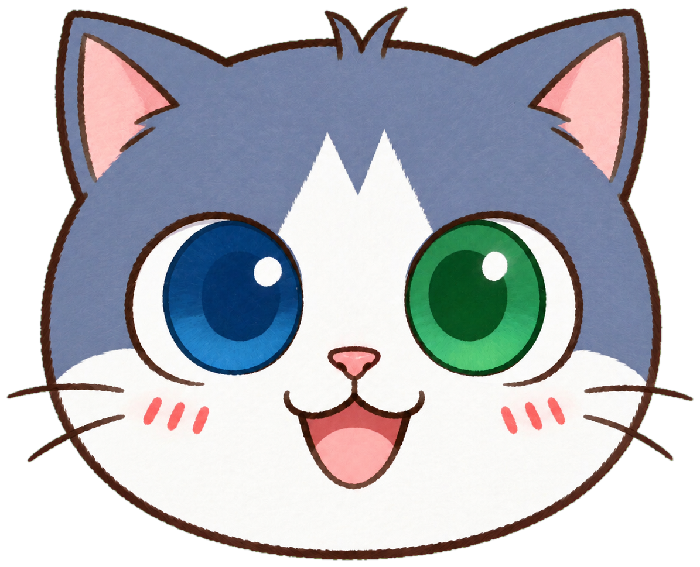

# 喵图 MeowTu

纯 Java（JDK 17）图像编辑工具，零第三方库，只用 JDK 自带 API。北航软件学院面向对象课程大作业。



## 功能

- **现代编辑界面**：深色主题，自写 Swing 美化组件库（圆角按钮、细滑杆、细滚动条、标签页等）
- **参数调节**：曝光、亮度、对比度、色温、色调、饱和度、自然饱和度、高光、阴影、白色、黑色、清晰度、锐化；基于查找表（LUT）引擎，拖动实时预览；撤销/重做（20 步）
- **格式转换**：PNG / JPG / BMP / GIF / TIFF 互转，另含手写 PPM / PGM 编解码；导出可设缩放与 JPEG 质量
- **几何变换**：旋转（90° 与任意角度）、翻转、裁剪（自由与常用比例）、透视矫正、桶形/枕形畸变、波浪、旋涡
- **滤镜（18 个）**：复古、老照片、黑白、褪色、日系、青橙、油画、素描、彩铅、浮雕、马赛克、水彩、梦幻柔光、光晕、X 光、红外、热力、夜视，均带强度滑杆
- **曲线调色**：RGB 合成与单通道曲线，样条插值，可拖动/增删控制点，带预设
- **直方图**：RGB 叠加与明度直方图，显示均值/中位数/标准差
- **文字工具**：多个文字对象，系统字体、字号、颜色、粗斜体、描边，画布拖动定位
- **前后对比**：左右分屏、滑块擦除、长按看原图三种模式
- **智能抠图**：GrabCut 图割算法（高斯混合模型 + 最大流最小割）纯 Java 实现，矩形框选 + 前景/背景画笔修补，引导滤波细化边缘，导出透明 PNG 或换背景色

## 运行方式

桌面版（需要 JDK 17 或更高）：

```bash
./build.sh        # 编译并生成 meowtu.jar
java -jar meowtu.jar
```

也可以直接双击 `meowtu.jar` 运行。

## 网页版

`web/` 目录是静态站点（可部署到 Cloudflare Pages 等静态托管）：页面通过 CheerpJ 在浏览器里直接运行与桌面版**同一个** `meowtu.jar`，无需服务器。

```text
web/index.html   网页版入口
web/meowtu.jar   与桌面版相同的程序包（build.sh 自动同步）
```

本地预览：在 `web/` 目录起一个静态服务器（如 `python3 -m http.server`）后打开 `index.html` 即可。

## 目录结构

```text
src/meowtu/          主程序与界面
src/meowtu/flatui/   自写 Swing 美化组件库
src/meowtu/core/     图像引擎（LUT 调节、几何、曲线、直方图、格式编解码）
src/meowtu/filters/  18 个滤镜
src/meowtu/grabcut/  GrabCut 抠图与引导滤波
assets/              LOGO
web/                 网页版静态站点
test/                无头冒烟测试
```
